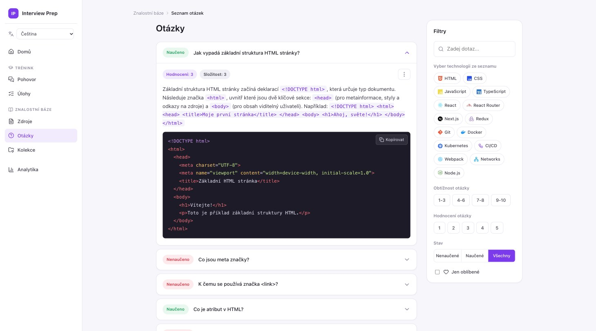
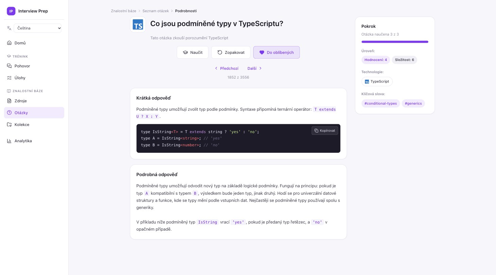
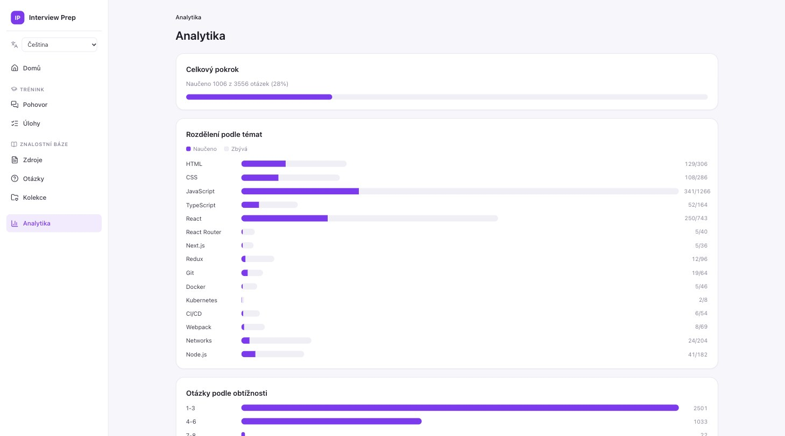

# Interview Prep

[](https://github.com/romanrudakevych/interview/actions/workflows/ci.yml)

A client-only React single-page app for studying technical-interview questions.
Browse a bank of 3,524 questions in any of four languages (Russian, English,
Czech, Ukrainian), filter by skill / difficulty / rating, expand short and long
answers with runnable code samples, track how well you know each question, star
favorites, solve coding exercises against real tests, and run a quick flash-card
interview simulation.

Everything runs in the browser. Question content is split into static JSON ahead
of time by `npm run build:data`; progress, filters and language choice live in
`localStorage`. There is no backend and no account.



## Features

- **Question bank** (`/knowledge-base/questions`) — 3,524 questions across 15
  skills as collapsible cards showing a learned/not-learned badge, and, when
  expanded, rating, complexity, the short answer, and an optional
  copy-to-clipboard code block. Answers are fetched on demand, so a collapsed
  card costs nothing.
- **Languages** — a selector in the sidebar footer switches both the interface and
  the question content between Russian, English, Czech and Ukrainian. A question
  with **no translation is hidden rather than falling back** to another language,
  so a partially translated locale would show a smaller bank; all three translated
  locales are currently complete, so every language shows all 3,524.
- **Filtering** — full-text query over question text and keywords, multi-select
  skill tags, difficulty buckets (`1-3`, `4-6`, `7-8`, `9-10`), rating chips,
  learned / not-learned status, and a "favorites only" toggle. The filter state
  is persisted between visits.
- **Question details** (`/knowledge-base/questions/:id`) — full long answer, a
  progress sidebar, clickable keyword tags that jump back to a filtered list, and
  Previous / Next navigation that follows whatever filter was active on the list.
- **Learn / Repeat / Favorite** — `Learn` bumps a per-question counter toward its
  goal; once the counter reaches the goal the question counts as *Learned*.
  `Repeat` resets the counter. `Favorite` toggles a star.
- **Interview simulation** (`/training/interview`) — a random question, reveal the
  answer, mark it known or not known (which drive `Learn` / `Repeat`), shuffle on.
- **Coding tasks** (`/training/tasks`) — 212 JavaScript exercises across 30
  categories, filterable by difficulty (1–5), language, and category. Each task (`/training/tasks/:id`) opens a
  description, a test-case list, and a code editor with syntax highlighting: **Run**
  executes your solution against the visible tests, **Submit** also runs hidden ones and
  marks the task solved. Code runs in a Web Worker with a 2s timeout, so an infinite loop
  can't freeze the page. Your code is saved as you type.
- **Resources** (`/knowledge-base/resources`) — 26 external learning materials
  (courses, books, repositories, channels, games…) with a link, thumbnail and
  description each, filterable by search, skill, and resource type. The catalog is
  generated by a script rather than hand-maintained — see
  [Scripts](#scripts).
- **Collections** (`/knowledge-base/collections`) — every question you've starred.
- **Analytics** (`/analytics`) — overall learned percentage, a per-skill
  learned-vs-remaining bar chart, and a question-count-by-difficulty chart.
- **Home** (`/`) — totals for questions, learned, favorites, and skills covered,
  plus quick links into the main sections.
- **Pagination** — the question list, task list and resource catalog all page
  through results with a shared `Pagination` component.

## Screenshots

**Question details** — short answer, long answer, code block, and the progress sidebar:



**Analytics** — overall progress plus a per-skill breakdown:



## Tech stack

| Purpose      | Choice                                                            |
| ------------ | ---------------------------------------------------------------- |
| UI           | React 19                                                         |
| Build / dev  | Vite 8 (`@vitejs/plugin-react`)                                  |
| Routing      | `react-router-dom` 7 (`BrowserRouter`)                          |
| Icons        | `react-icons` (Simple Icons) + `lucide-react`                   |
| i18n         | Hand-rolled (`src/i18n/`), no library                            |
| Code execution | Web Worker raced against a 2 s timeout (`src/utils/runCode.js`) |
| Syntax highlighting | Hand-rolled tokenizer (`src/utils/highlightCode.js`), no library |
| Linting      | Oxlint (`react` + `oxc` plugins)                                |
| Tests        | Vitest + Testing Library, jsdom (`vitest.config.js`)            |
| Styling      | One hand-written global stylesheet (`src/index.css`), no CSS framework |

No TypeScript and no state-management library — runtime state lives in three
React contexts (`LanguageProvider`, `QuestionsProvider`, `TasksProvider`).

Tests run on **Vitest** rather than Jest, because the suite reuses the real
`vite.config.js`: `src/utils/questionBodies.js` and
`src/context/QuestionsContext.jsx` load their data through `import.meta.glob`,
and `src/utils/runCode.js` builds its worker with
`new Worker(new URL(..., import.meta.url))`. Both are Vite constructs with no
meaning outside it, so any other runner would need those three modules rewritten
or mocked. The test API is Jest-compatible (`describe` / `it` / `expect` /
`vi.fn`).

## Getting started

Requires Node.js **20.19+** or **22.12+** to run and build the app (Vite 8),
declared in `engines` so npm warns on anything older.

**Running the test suite needs 22.12+**, which is a higher floor than the app
itself: `vitest` asks for `^22.12.0 || ^24.0.0 || >=26.0.0`, `jsdom` for
`^22.22.2 || ^24.15.0 || >=26.0.0`, and `@testing-library/jest-dom` for `>=22`.
CI enforces both bounds — the full suite on 22.x, and a build-only job on 20.19
so the lower bound stays a tested claim rather than an assumed one.

```bash
npm install
npm run dev        # start the dev server with HMR — http://localhost:5173
```

### Scripts

| Script            | Description                                                      |
| ----------------- | -------------------------------------------------------------- |
| `npm run dev`     | Vite dev server with hot module replacement                     |
| `npm run build`   | Production build to `dist/` (also the quickest compile check)   |
| `npm run preview` | Serve the production build locally                              |
| `npm run lint`    | Run Oxlint (config: `.oxlintrc.json`)                           |
| `npm test`        | Run the test suite once (regenerates the split data first)      |
| `npm run test:watch` | Re-run affected tests as files change                        |
| `npm run test:coverage` | Run with coverage; fails below the configured thresholds  |
| `npm run build:data` | Regenerate the split question data (runs automatically before dev/build) |
| `npm run deploy`  | Build and publish `dist/` to the `gh-pages` branch              |

One script is deliberately **not** an npm script, so that no build ever needs the
network: `scripts/import-resources.mjs`, which regenerates `src/data/resources.js`
from an upstream catalog API. The endpoint is not stored in the repo — supply it
when running the import:

```bash
RESOURCES_API_URL="<catalog endpoint>" node scripts/import-resources.mjs
```

It exits with a usage message if the URL is missing. Edit the script rather than
the generated data file.

## Deployment (GitHub Pages)

The app is a static SPA and is hosted on GitHub Pages at
**https://romanrudakevych.github.io/interview/**.

```bash
npm run deploy   # runs the build, then pushes dist/ to the gh-pages branch
```

One-time setup on GitHub: **Settings → Pages → Build and deployment → Source:
"Deploy from a branch"**, branch **`gh-pages`**, folder **`/ (root)`**.

How it works:

- `vite.config.js` sets `base: '/interview/'` so assets resolve under the
  project-site subpath, and `App.jsx` passes `basename={import.meta.env.BASE_URL}`
  to the router.
- `public/404.html` + a small decoder snippet in `index.html` implement the
  [spa-github-pages](https://github.com/rafgraph/spa-github-pages) redirect so deep
  links (e.g. `/interview/knowledge-base/questions/994`) don't 404 on refresh.
- `gh-pages -d dist --nojekyll` publishes the build (the `--nojekyll` flag keeps
  Vite's `_`-prefixed asset files servable).

## Architecture

### Static content vs. persisted progress

The central design constraint: **question content and user progress are stored
separately**, so editing the question bank never wipes learning progress and
vice-versa.

- **`src/data/questions.js`** — the static bank and source of truth, built from an
  internal `rawQuestions` list via `createQuestion()`. At ~11 MB it is **never
  bundled**: `scripts/build-questions-data.mjs` splits it into a small eagerly-loaded
  index per language (~100 KB gzipped) plus 36 lazy answer chunks of 100 questions
  each (~78 KB gzipped apiece), so a visitor downloads ~225 KB of app plus one
  index instead of 2.7 MB of question bank. Answers are fetched on demand by
  `useQuestionBody()` — pass `null` to skip the fetch, which is how collapsed
  cards stay inert. The generated `src/data/generated/` directory is gitignored
  and rebuilt by `predev` / `prebuild`.
  **IDs are the array position (`index + 1`)**, never stored
  in the data — a random id generated at module load would change on every
  refresh and orphan saved progress. The trade-off: reordering or deleting
  existing entries shifts ids and disconnects their progress. **Appending new
  entries at the end is always safe.**
- **`src/utils/storage.js`** — thin `localStorage` wrappers for six independent
  keys: per-question progress (`status` / `favorite` / `learnedCount` /
  `learnedGoal`), question filters, task progress, task filters, resource filters
  and language choice. Every read and write is wrapped in try/catch and degrades
  silently, so private mode or a full quota can't throw.
- **`src/context/QuestionsContext.jsx`** (`QuestionsProvider` / `useQuestions()`)
  — the runtime source of truth. It merges the static `questions` array with
  saved progress and **derives `status` from `learnedCount >= learnedGoal`**
  rather than trusting a stored field, so the *Learned* badge can't drift out of
  sync with the count. It also owns filter state (`DEFAULT_FILTERS`, `setFilters`,
  `resetFilters`).
- **`src/data/tasks.js` + `src/context/TasksContext.jsx`** — the coding-task
  feature repeats the same split with its **own** `localStorage` keys. Task
  `status` is likewise derived, not trusted: it comes from the `solved` flag plus
  whether saved code differs from `starterCode`.

### Translated question content

`ru` is the source bank (`src/data/questions.js`); `cs`, `en` and `uk` each carry
a translation file in `src/data/translations/`. All three claim all 15 skills and
cover the whole bank — 3,524 of 3,524 questions each. Three rules are
load-bearing here, and each one will stop a build rather than ship something
wrong:

- Each translation file declares **`coverage`**, the list of skills it claims. A
  claimed skill must be **100 % translated or `build:data` fails**; entries for
  unclaimed skills are *staged* — reported by the generator and excluded from the
  shipped data — which is how a half-finished skill block can sit in the file
  without ever reaching a user.
- Every entry carries the Russian **`source`** text it was translated from, and
  the generator fails the build if `questions.js` no longer matches
  position-for-position. Ids are array positions, so this is what catches a
  reorder that would silently attach a translation to the wrong question.
- Because all three locales are complete, **adding a question to `questions.js`
  now breaks the Czech, English and Ukrainian builds** until it is translated in
  each, whatever skill it is tagged with.

Generated artifacts are per-language (`index.<lang>.json` plus
`bodies/<lang>/NNN.json`), and chunking keys on the *global* id, so a sparse
language simply writes fewer files.

### Shared behavior hooks

- **`src/hooks/useQuestionActions.js`** is the single implementation of
  `learn` / `repeat` / `toggleFavorite` / `canRepeat`. Both the list-view
  dropdown (`QuestionCardMenu`) and the details-page bar (`QuestionActionsBar`)
  call into it, so the two surfaces can't diverge.
- **`src/hooks/useFilteredQuestions.js`** derives the visible list from the
  context's `questions` + `filters`. Its pure `filterQuestions(questions, filters)`
  export is reused by the details page to compute Previous / Next order
  consistent with the active list filter.

### Icons

`src/utils/skillIcons.jsx` centralizes the skill → icon / color mapping (brand
icons from `react-icons/si`, `lucide-react` fallbacks for CI/CD and Networks).
Use `SKILL_META` / `<SkillIcon skill=… />` instead of importing icons elsewhere.

## Tests

```bash
npm test                 # once
npm run test:watch       # on change
npm run test:coverage    # with coverage, enforcing thresholds
```

948 tests across 46 files, co-located as `src/**/*.test.{js,jsx}`; only shared
setup, fixtures and helpers live under `test/`. Coverage sits at ~99% of
statements and ~98% of branches, and `test:coverage` fails below the thresholds
in `vitest.config.js` so new untested code can't quietly lower the bar.

What the suite is actually guarding, beyond the obvious:

- **The tokenizer's escaping**, which is a security property rather than a
  cosmetic one — its output goes through `dangerouslySetInnerHTML` and one
  caller's input is user-typed code. `highlightCode.corpus.test.js` re-runs the
  round-trip check over **every** `codeExample` in all four languages (~13,000
  blocks) and asserts each one survives byte-for-byte, which is the only way to
  catch a regex that silently eats characters.
- **`status` is derived, never trusted from storage**, for both questions and
  tasks, so a "Learned" badge can't drift from its count.
- **Ids are array positions** and are the join key for saved progress: the
  generated index, every body chunk and `meta.json` are all checked against the
  source bank.
- **The translation rules**: `validate()` is exercised against synthetic
  translation maps for all four of its failure paths (source drift, a partially
  translated claimed skill, an unknown skill, empty coverage).
- **Storage never throws** — every loader is tested against a throwing
  `localStorage`, malformed JSON and a quota error.
- **Run vs Submit**: only a Submit that passes the hidden tests too can mark a
  task solved.
- **The 2 s worker timeout** terminates the worker rather than just resolving,
  and `runCode` never rejects or settles twice.

Every push to `master` and every pull request runs lint, the suite with
coverage, the worker's own coverage check and a production build
(`.github/workflows/ci.yml`, Node 22.x). The coverage report is uploaded as an
artifact, which is what you want when a threshold fails and the summary alone
doesn't say which lines went uncovered.

Two notes for whoever runs this next:

- Every test script regenerates `src/data/generated/` first through its own
  `pre*` hook (~0.4 s). Without that data the config fails fast with a message
  saying what to run, because `import.meta.glob` resolves that directory at
  transform time — which is also why each entry point needs its own hook rather
  than relying on `pretest`.
- `src/workers/runner.worker.js` is excluded from the main coverage report and
  measured by `npm run test:coverage:worker` instead (100% statements and
  branches). It is loaded twice — directly by its own suite and again through
  `@vitest/web-worker` — and the second, barely-exercised copy is what the
  merged report keeps.

## Project structure

```
.github/workflows/ci.yml     # lint + tests + coverage + build, on push and PR
screenshots/                 # images used by this README
public/                      # favicon + 404.html (SPA redirect for GitHub Pages)
scripts/
├── build-questions-data.mjs # splits the question bank into generated/ (predev/prebuild)
└── import-resources.mjs     # regenerates resources.js; needs RESOURCES_API_URL
src/
├── main.jsx                 # React entry point
├── App.jsx                  # Language + Questions + Tasks providers, BrowserRouter, routes
├── index.css                # single global stylesheet
├── data/
│   ├── skills.js            # SKILLS — its own module so UI code needn't import the bank
│   ├── questions.js         # static question bank (re-exports SKILLS); never bundled
│   ├── tasks.js             # static coding-task bank (TASK_CATEGORIES / TASK_LANGUAGES)
│   ├── resources.js         # external-resource catalog (generated by import-resources.mjs)
│   ├── translations/        # cs.js / en.js / uk.js — question content + `coverage`
│   └── generated/           # gitignored build output: index.<lang>.json + bodies/<lang>/
├── i18n/
│   ├── index.jsx            # LanguageProvider / useI18n() / t() with plural rules
│   └── locales/             # en.js / uk.js / ru.js / cs.js — flat dot-key maps
├── context/
│   ├── QuestionsContext.jsx # runtime source of truth: merges data + progress, owns filters
│   └── TasksContext.jsx     # the same, for coding tasks, on its own storage keys
├── hooks/
│   ├── useQuestionActions.js   # Learn / Repeat / Favorite logic (used by every surface)
│   ├── useFilteredQuestions.js # derives the visible list; exports pure filterQuestions()
│   ├── useFilteredTasks.js     # the same, for coding tasks
│   ├── useQuestionBody.js      # lazily fetches one question's answers; null = skip
│   └── useResources.js         # resource list + its persisted filters
├── utils/
│   ├── storage.js           # localStorage read/write wrappers (six keys)
│   ├── questionBodies.js    # loads + caches answer chunks, keyed by `lang:chunk`
│   ├── runCode.js           # spawns the worker, races it against a 2s timeout
│   ├── highlightCode.js     # hand-rolled tokenizer; escapes as it emits
│   └── skillIcons.jsx       # skill → icon + color mapping (SKILL_META / <SkillIcon />)
├── workers/
│   └── runner.worker.js     # executes user solutions off the main thread
├── pages/
│   ├── HomePage.jsx
│   ├── QuestionListPage.jsx
│   ├── QuestionDetailsPage.jsx
│   ├── InterviewPage.jsx
│   ├── AnalyticsPage.jsx
│   ├── CollectionsPage.jsx
│   ├── TasksPage.jsx        # coding-task list
│   ├── TaskDetailsPage.jsx  # description + tests + code editor
│   └── ResourcesPage.jsx    # external-resource catalog
└── components/
    ├── Sidebar.jsx          # persistent nav
    ├── LanguageSelect.jsx   # native <select> in the sidebar footer
    ├── Breadcrumbs.jsx
    ├── Pagination.jsx       # shared by the question, task and resource lists
    ├── FilterSidebar.jsx
    ├── TaskFilterSidebar.jsx
    ├── ResourceFilterSidebar.jsx
    ├── ResourceCard.jsx
    ├── TaskCard.jsx
    ├── QuestionCard.jsx
    ├── QuestionCardMenu.jsx
    ├── QuestionActionsBar.jsx
    ├── ProgressSidebar.jsx
    ├── TestResults.jsx      # renders worker results; maps error codes through t()
    ├── CodeEditor.jsx       # textarea over a highlighted <pre> + gutter
    ├── FormattedText.jsx    # renders `backtick` spans as inline <code>
    └── CodeBlock.jsx        # <pre> block with copy-to-clipboard
test/                        # test support only — the tests live beside their source
├── setup.js                 # matchers, per-test cleanup, the jsdom gaps the app hits
├── fixtures/                # hand-written questions / tasks / resources
├── helpers/                 # renderWithProviders, the context doubles
└── scripts/                 # tests for the two Node scripts (run them as subprocesses)
```

### Routes

| Path                            | Page                    |
| ------------------------------- | ----------------------- |
| `/`                             | Home                    |
| `/training/interview`           | Interview simulation    |
| `/training/tasks`               | Coding task list        |
| `/training/tasks/:id`           | Coding task details     |
| `/knowledge-base/resources`     | Resource catalog        |
| `/knowledge-base/questions`     | Question list           |
| `/knowledge-base/questions/:id` | Question details        |
| `/knowledge-base/collections`   | Favorites               |
| `/analytics`                    | Analytics               |
| `*`                             | redirect to `/`         |

## The question bank

`SKILLS` (fixed list, defined in `src/data/skills.js` and re-exported by
`questions.js`):

```
HTML · CSS · JavaScript · TypeScript · React · React Router · Next.js ·
Redux · Git · Docker · Kubernetes · CI/CD · Webpack · Networks · Node.js
```

### Adding a question

Append an object to `rawQuestions` in `src/data/questions.js`:

```js
{
  question: "Question text",
  shortAnswer: "Short answer. Mark inline code with backticks: `<tag>`.",
  longAnswer: "Full, detailed answer. Blank lines separate paragraphs.",
  codeExample: `console.log("optional — delete this field if not needed")`,
  skills: ["React"],            // one or more names from SKILLS
  keywords: ["#hooks", "#useEffect"],
  difficulty: 4,                // 1–10
  rating: 3,                    // 1–5 (importance)
}
```

- **Do not** set `id` — it is derived from array position.
- **Do not** set progress fields (`status`, `favorite`, `learnedCount`,
  `learnedGoal`); `createQuestion()` fills defaults (`learnedGoal: 3`) and real
  values live in `localStorage`.
- Inline code in `shortAnswer` / `longAnswer` uses `` `backticks` ``
  (`FormattedText` turns those into `<code>`); `codeExample` renders as a
  `CodeBlock` with a copy button.
- **You must also translate it.** `cs`, `en` and `uk` each cover the whole bank,
  and a claimed skill has to be 100 % translated, so a new question breaks all
  three builds until it is added to every file in `src/data/translations/` — with
  the Russian text copied verbatim into its `source` field. See the
  "Translated question content" section of `CLAUDE.md` for the details.

## Built with Claude Code

This project — application code, question bank, and this README — was created
entirely with [Claude Code](https://claude.com/claude-code).

## License

No license file is included; all rights reserved by the author unless stated
otherwise.
